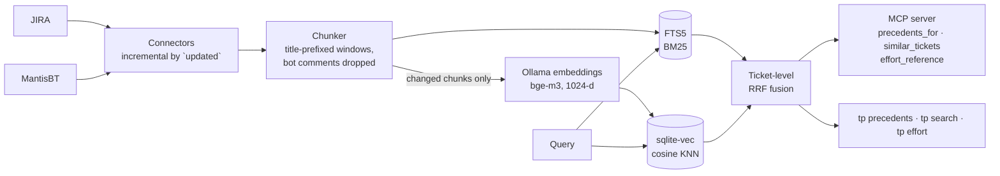

# ticket-precedent

[](https://github.com/bondie/ticket-precedent/actions/workflows/ci.yml)


**Have we solved this before?** Local hybrid search over your JIRA and helpdesk history,
exposed to AI agents through the [Model Context Protocol](https://modelcontextprotocol.io).

A customer reports *"the invoice never showed up in the shop"*. Eight months ago a developer
fixed the same thing in a ticket titled *"ERP comparator drops payload as unchanged"*.
Keyword search cannot connect the two, and pure embeddings fumble exact identifiers such as
ticket keys, class names and error codes. ticket-precedent indexes tickets **and their
comments** from JIRA and MantisBT into a single SQLite file and ranks them with BM25 and
vector search fused by Reciprocal Rank Fusion. Embeddings are computed locally with Ollama,
so ticket content never leaves your machine.

In Claude Code (or any MCP client) you ask *"find precedents for helpdesk 18342"*, and the
agent gets the earlier tickets that look like it. The command line gives the same results
(illustrative output):

```text
$ uv run tp precedents 18342
precedents for [acme-helpdesk] 18342 Invoice missing in the shop
1. [acme-jira] SHOP-412 ERP comparator drops payload as unchanged
   Done Fixed · 3.5 h · https://jira.example.com/browse/SHOP-412
   Root cause: the comparator hashed the payload without the PDF, so the re-sent invoice …
2. [acme-helpdesk] 17105 Credit note not visible in the customer account
   closed fixed · https://helpdesk.example.com/view.php?id=17105
   The ERP export finished but the shop kept the old document list. Resetting the …
```

## Getting started

You need [uv](https://docs.astral.sh/uv/) and [Ollama](https://ollama.com).

**1. Start Ollama and download the embedding model.** On macOS:

```bash
brew install ollama && brew services start ollama   # starts now and at every login
ollama pull bge-m3                                   # ~1.2 GB, multilingual
```

On Linux the [official installer](https://ollama.com/download) sets up a systemd service.

**2. Install ticket-precedent.**

```bash
git clone https://github.com/bondie/ticket-precedent && cd ticket-precedent
uv sync
```

**3. Describe your trackers.** The configuration lives outside the repository:

```bash
mkdir -p ~/.config/ticket-precedent
cp config.example.yaml ~/.config/ticket-precedent/config.yaml
```

Edit the `sources` list, with one entry per JIRA query or MantisBT project set. Keep the
secrets out of the file: `${VARIABLES}` are resolved from the environment, from a `.env` next
to the config, or from the files listed in `env_files`. See
[`config.example.yaml`](config.example.yaml) for every option.

**4. Build the index.**

```bash
uv run tp sync
uv run tp stats            # tickets and chunks per source, last sync time
```

The first sync fetches everything and embeds about 15 chunks per second on an Apple M1 Pro.
A project with 3,600 tickets and their comments (17,000 chunks) takes about 20 minutes.
Later syncs fetch only tickets updated since the previous one and embed only changed text.
The index is a single file in `~/.local/share/ticket-precedent/`.

**5. Connect it to Claude Code.** Run this in the repository directory:

```bash
claude mcp add ticket-precedent -s user -- uv --directory "$PWD" run tp serve
```

`-s user` makes the tools available in every project. New Claude Code sessions pick them
up, and `claude mcp list` shows whether the server connects. Other MCP clients (Claude
Desktop, Cursor, …) start the same stdio server:

```json
{
  "mcpServers": {
    "ticket-precedent": {
      "command": "uv",
      "args": ["--directory", "/path/to/ticket-precedent", "run", "tp", "serve"]
    }
  }
}
```

## Everyday use

### Ask your agent

Describe the problem in your own words and let the agent pick the tool:

| You ask | The agent calls |
|---|---|
| *Find precedents for helpdesk 18342.* | `precedents_for("18342")` |
| *Have we seen "invoice PDF missing although ERP exported it" before?* | `similar_tickets(text)` |
| *Open SHOP-412 and tell me how it was fixed.* | `get_ticket("acme-jira", "SHOP-412")` |
| *How long will SHOP-431 take?* | `effort_reference(key="SHOP-431")` |
| *How long did similar fixes take since we changed the process in January?* | `effort_reference(text, since="2026-01-01")` |

| Tool | What it does |
|---|---|
| `precedents_for(key, source?, only_source?, limit?)` | Precedents for a ticket that is already indexed |
| `similar_tickets(text, source?, project?, limit?)` | Precedents for any text: a symptom, an error message, a ticket that is not indexed yet |
| `effort_reference(key? \| text?, source?, since?, limit?)` | Similar finished tickets with logged hours, plus their median and P25–P75 |
| `get_ticket(source, key)` | Full indexed description, comments and links of one ticket |
| `list_sources()` | Indexed sources, counts and last sync time |

`precedents_for` queries with the ticket's title and description, exactly like the
[benchmark](#results). It returns only tickets created before that ticket and leaves out the
ticket itself. It also leaves out tickets named in the ticket's title: a JIRA issue titled
*"[R:18342] Wrong prices"* was opened from helpdesk thread 18342, so that thread is the same
problem, not a precedent. The key alone is enough. `source` is needed only when two sources
share a key.

`effort_reference` is the retrieval half of
[reference class forecasting](https://en.wikipedia.org/wiki/Reference_class_forecasting): an
estimate starts from how long similar work actually took. See
[Effort reference](#effort-reference).

Every result carries the key, title, URL, status, resolution, issue type, creation date,
time spent and a snippet of the best-matching text. `matched_in` says whether that text is
the description, a comment or only the title. `score` is the fusion score: it orders the results and is not a
probability. All tools are read-only and read only the local index.

### Use the command line

| Command | What it does |
|---|---|
| `tp precedents KEY [--only-source S] [--platform P] [--limit N] [--json]` | Earlier tickets that look like an indexed ticket |
| `tp search TEXT [--source S] [--project P] [--platform P] [--mode hybrid\|vector\|bm25] [--json]` | Search by free text |
| `tp effort KEY [--since YYYY-MM-DD] [--platform P] [--limit N] [--json]` | Logged hours of similar tickets finished before KEY was created |
| `tp show SOURCE KEY` | Print one indexed ticket as JSON |
| `tp sync [--source S] [--full]` | Fetch new and updated tickets; `--full` re-reads everything |
| `tp stats` | Indexed sources and sync times |
| `tp serve` | MCP server on stdio (MCP clients start it for you) |
| `tp eval PROJECT` | Benchmark on a public Apache JIRA project |

Run them as `uv run tp …` from the repository directory. `tp --config PATH …` uses another
configuration file.

### Keep products apart

One index can hold the trackers of products that should not be compared, for example a
legacy shop platform and its successor: the same kind of ticket takes a very different
effort on each. Give every source a `platform` and the searches stay within one:

- `precedents_for` and `effort_reference` with a key keep to the platform of that ticket.
- `similar_tickets` and `effort_reference` with text use the `platform` argument, or
  `default_platform` from the configuration when it is omitted.
- `platform: "all"` searches every source; `list_sources` shows the platform of each.

Sources without a platform, and configurations without `default_platform`, search
everything as before.

### Keep the index fresh

- **Automatically.** With `auto_sync_hours` set, every new MCP session checks the sources
  when it starts. Any source older than that limit is refreshed in a background thread, so
  no scheduler is needed. A file lock keeps concurrent syncs (CLI, several open sessions) from
  colliding.
- **On demand.** `tp sync`, or a cron job.
- **After changing chunking settings**, for example raising `min_comment_chars` to drop short
  "deployed, please check" comments, run `tp sync --full`. Unchanged chunks keep their
  embeddings, so this costs mostly API calls.

### What has to be running

- **The MCP server** is started by the client (Claude Code, Cursor, …) for each session and
  stops with it. There is no daemon to manage.
- **Ollama** embeds the query. An idle Ollama server uses about 70 MB of RAM. The model is
  loaded on the first query (a few seconds) and unloaded after five idle minutes. If Ollama
  is not reachable, search degrades to BM25 and says so in a `warning` field instead of
  failing.

## Results

The benchmark asks the tool to find duplicates on public Apache JIRA projects (see the
[methodology](#evaluation-methodology)). Embeddings come from `bge-m3` through Ollama on an
Apple M1 Pro. The fusion parameters were tuned on ZooKeeper and applied to Derby unchanged.

**ZooKeeper**: 4,922 tickets, 105 duplicate queries

| Method | Indexed text | Hit@1 | Hit@5 | Hit@10 | MRR@10 (95% CI) |
|---|---|---:|---:|---:|---:|
| BM25 | title + description | 0.467 | 0.648 | 0.686 | 0.538 (0.45-0.63) |
| Vector | title + description | 0.600 | 0.762 | 0.790 | 0.662 (0.58-0.74) |
| Hybrid | title + description | 0.619 | 0.771 | 0.800 | 0.671 (0.59-0.75) |
| BM25 | + comments | 0.562 | 0.724 | 0.781 | 0.638 (0.55-0.72) |
| Vector | + comments | 0.610 | 0.829 | 0.838 | 0.695 (0.62-0.77) |
| **Hybrid** | **+ comments** | **0.648** | **0.838** | **0.857** | **0.719 (0.64-0.80)** |

**Derby** (held out): 7,169 tickets, 153 duplicate queries

| Method | Indexed text | Hit@1 | Hit@5 | Hit@10 | MRR@10 (95% CI) |
|---|---|---:|---:|---:|---:|
| BM25 | title + description | 0.418 | 0.595 | 0.673 | 0.500 (0.43-0.57) |
| Vector | title + description | 0.490 | 0.634 | 0.699 | 0.551 (0.48-0.62) |
| Hybrid | title + description | 0.490 | 0.654 | 0.725 | 0.559 (0.49-0.63) |
| BM25 | + comments | 0.425 | 0.667 | 0.732 | 0.532 (0.46-0.60) |
| Vector | + comments | 0.556 | 0.752 | 0.791 | 0.636 (0.57-0.70) |
| **Hybrid** | **+ comments** | **0.562** | **0.752** | **0.797** | **0.647 (0.58-0.71)** |

What the numbers say:

- **Indexing comments gives the biggest gain.** With comments, hybrid Hit@10 rises by 6 to 7
  points and MRR by 0.05 to 0.09. Comments hold the diagnosis (stack traces, class names,
  the root cause) that the original description often lacks.
- **Embeddings beat BM25 on every run**, by 0.05 to 0.12 MRR. Duplicates are reported by
  different people in different words.
- **Hybrid is the best or tied on every run, but the right BM25 weight depends on the
  project.** On ZooKeeper without comments, plain RRF (`k=60`, equal weights) scored 0.599
  MRR, which is *below* vectors alone (0.662). With `rrf_k=10` and the lexical ranking
  weighted 0.25, it reaches 0.671. Derby was not used for tuning, and it prefers a heavier
  BM25 weight: with comments, equal weights reach 0.661 and the default reaches 0.647. The
  default of 0.25 is the conservative choice, because it scored above vector search on all
  four runs. Neither these differences nor hybrid's lead over pure vector search (0.01 to
  0.02 MRR) are larger than the confidence intervals, so the benchmark does not prove that
  hybrid is better. Hybrid stays the default because exact identifiers (error codes, ticket
  keys, class names) are where BM25 is strong and embeddings are weak, and this benchmark
  does not isolate that case.
- **Latency.** At p50, searching the local index takes 15 to 50 ms without comments. With
  comments it takes up to 212 ms (hybrid over Derby's 61k chunks). Embedding the query
  adds about 0.2 s (1,000 characters, model already loaded).

Reproduce a run, or the fusion parameter grid, with:

```bash
uv run tp eval ZOOKEEPER --no-comments       # ~5k tickets, about 10 minutes
uv run tp eval DERBY --out results/derby-comments-bge-m3.json
uv run python scripts/tune_fusion.py ~/.local/share/ticket-precedent/eval/apache-derby-comments-bge-m3.db
```

The per-query ranks for every run are in [`results/`](results/).

## How it works



- **One file, no services.** FTS5 and [sqlite-vec](https://github.com/asg017/sqlite-vec)
  live in the same SQLite database as the tickets, so the index is easy to back up, move
  or throw away.
- **Hybrid ranking.** BM25 catches exact tokens (error codes, class names), embeddings catch
  paraphrases and cross-language matches. Reciprocal Rank Fusion merges the two rankings
  without calibrating their scores against each other.
- **Ticket-level results.** Every chunk carries the ticket title. Chunks are ranked first and
  then collapsed to their best chunk per ticket, so a long thread cannot crowd out the list.
- **Incremental sync.** Chunks are content-hashed and only new or changed text is embedded.
  Re-syncing an unchanged project costs API calls but no GPU time.
- **Long queries.** A pasted ticket can have hundreds of terms. The lexical side keeps the
  64 rarest terms that exist in the index, using FTS5 vocabulary statistics.
- **Multilingual.** bge-m3 handles mixed Czech and English. BM25 folds diacritics, so
  *objednávka* and *objednavka* match.

## Effort reference

`effort_reference` answers "how long did work like this take?" with the logged time of the
most similar tickets, never with a model's guess. It is meant as the input of an estimating
agent, which adjusts the range and cites the tickets.

- **Only finished work counts.** A ticket joins the reference class once its time was all
  logged, so a ticket still in progress cannot pull the median down. For an indexed ticket
  the cut-off is the moment it was created: the answer is what could have been known when it
  was estimated. That makes the tool usable for backtests without leaking the future.
- **When was the time final?** The JIRA connector reads each issue's changelog and keeps
  the moment time was last logged. When sub-tasks carry part of the time, their worklogs
  are not in the parent's changelog, so the last update stands in for it.
- **What did people forecast?** The index also keeps the original estimate as it stood when
  the first time was logged. Trackers often raise the estimate to match the time spent once
  the work is done, so the current value is a record of the effort, not a forecast. The tool
  never returns it: it is there to compare an agent's estimate with the human one.
- **Process changes.** `since` keeps only tickets created after a date. When a team changes
  how it works, for example by implementing with AI agents, older tickets overstate the
  effort and a recent reference class is the better guide.
- **Quartiles, not a mean.** Logged time is skewed: a few tickets take ten times the usual.
  The median and the P25–P75 range ignore the outliers that a mean would chase.

The changelog makes JIRA pages slower, so sources sync 50 issues per request. Set
`changelog: false` on a source that does not need effort data. After upgrading from an
index without these fields, run `tp sync --full` once.

## Evaluation methodology

There is no labelled "precedent" dataset for private trackers, but public issue trackers
contain one implicitly: tickets **closed as duplicates**.

- Corpus: every ticket of an Apache JIRA project, fetched anonymously through the REST API.
- Queries: each ticket resolved as *Duplicate*, using only its title and description
  (truncated to 2,000 characters), which is what a reporter writes before anyone answers.
- Relevant answers: the **earlier** tickets in the same duplicate cluster (connected
  component of *Duplicate* links).
- No leakage from the future: search is restricted to tickets created before the query,
  and the query ticket itself is excluded.
- Metrics: Hit@k (a relevant ticket is in the top k) and MRR@10. The 95% interval for MRR is
  a percentile bootstrap: 2,000 resamples of the queries with a fixed seed.

Caveat: the index reflects the trackers' current state, so a comment written on an original
ticket after the duplicate was filed can still help the search. Titles and descriptions,
the bulk of the signal, rarely change after creation.

## Development

```bash
uv sync
uv run pytest --cov          # unit and integration tests, no network or GPU needed
uv run ruff check . && uv run ruff format --check .
uv run mypy                  # strict mode
uvx pre-commit install       # ruff, mypy and gitleaks on every commit
```

CI runs lint, type checks, tests on Python 3.11–3.13 and a gitleaks secret scan.

## Roadmap

- Collapse clones and sub-tasks that share a title into one result
- Cross-encoder reranking of the top candidates (`bge-reranker-v2-m3`)
- Embedding model comparison (`qwen3-embedding`, `multilingual-e5`, `snowflake-arctic-embed2`)
- GitLab and GitHub Issues connectors, JIRA Cloud (`/rest/api/3/search/jql`)
- Periodic re-sync while a server session stays open (today auto-sync runs only at start-up)

## License

[MIT](LICENSE)
