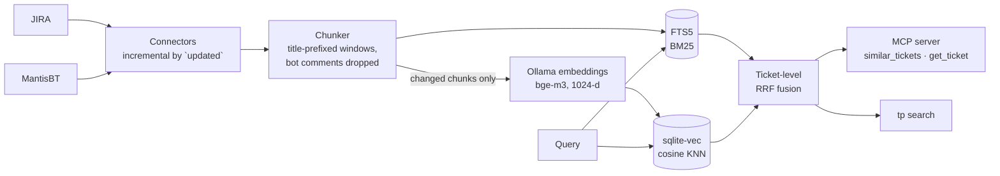

# ticket-precedent

[](https://github.com/bondie/ticket-precedent/actions/workflows/ci.yml)


**Have we solved this before?** Local hybrid search over your JIRA and helpdesk history,
exposed to AI agents through the [Model Context Protocol](https://modelcontextprotocol.io).

A customer reports *"the invoice never showed up in the shop"*. Eight months ago a developer
fixed the same thing in a ticket titled *"ERP comparator drops payload as unchanged"*.
Keyword search cannot connect the two, and pure embeddings fumble exact identifiers such as
ticket keys, class names and error codes. ticket-precedent indexes tickets **and their
comments** from JIRA and MantisBT into a single SQLite file and ranks them with BM25 and
vector search fused by Reciprocal Rank Fusion. Embeddings are computed locally with Ollama,
so ticket content never leaves your machine.

<!-- RESULTS -->

## How it works



- **One file, no services.** FTS5 and [sqlite-vec](https://github.com/asg017/sqlite-vec)
  live in the same SQLite database as the tickets, so the index is easy to back up, move
  or throw away.
- **Hybrid ranking.** BM25 catches exact tokens (error codes, class names), embeddings catch
  paraphrases and cross-language matches. Reciprocal Rank Fusion merges the two rankings
  without calibrating their scores against each other.
- **Ticket-level results.** Every chunk carries the ticket title. Chunks are ranked first and
  then collapsed to their best chunk per ticket, so a long thread cannot crowd out the list.
- **Incremental sync.** Chunks are content-hashed and only new or changed text is embedded.
  Re-syncing an unchanged project costs API calls but no GPU time.
- **Long queries.** A pasted ticket can have hundreds of terms. The lexical side keeps the
  64 rarest terms that exist in the index, using FTS5 vocabulary statistics.
- **Multilingual.** bge-m3 handles mixed Czech and English. BM25 folds diacritics, so
  *objednávka* and *objednavka* match.

## Quick start

Requirements: [uv](https://docs.astral.sh/uv/) and [Ollama](https://ollama.com).

```bash
ollama pull bge-m3
git clone https://github.com/bondie/ticket-precedent && cd ticket-precedent
uv sync

# Reproduce the benchmark on public Apache JIRA data (~5k tickets).
uv run tp eval ZOOKEEPER --no-comments
```

### Index your own trackers

```bash
mkdir -p ~/.config/ticket-precedent
cp config.example.yaml ~/.config/ticket-precedent/config.yaml   # edit sources and secrets
uv run tp sync                     # first run fetches everything, later runs only changes
uv run tp search "invoice is not visible in the shop although ERP sent it"
uv run tp show acme-helpdesk 18342
```

Configuration lives outside the repository (`~/.config/ticket-precedent/`), and the index
lives in `~/.local/share/ticket-precedent/`. `${VARIABLES}` in the config are resolved from
the environment, from a `.env` next to the config, or from the files listed in `env_files`.
See [`config.example.yaml`](config.example.yaml).

### Use it from Claude Code or any MCP client

```bash
claude mcp add ticket-precedent -s user -- uv --directory "$PWD" run tp serve
```

| Tool | What it does |
|---|---|
| `similar_tickets(text, source?, project?, limit?)` | Ranked precedents with status, resolution, time spent and the matching snippet |
| `get_ticket(source, key)` | Full indexed description, comments and links of one ticket |
| `list_sources()` | Indexed sources, counts and last sync time |

All tools are annotated read-only. Searching reads only the local index, so the server needs
no tracker credentials for it.

### What has to be running

- **The MCP server** is started by the client (Claude Code, Cursor, …) for each session and
  stops with it. There is no daemon to manage.
- **Ollama** embeds the query. An idle Ollama server uses about 70 MB of RAM; the model
  is loaded on the first query (a few seconds) and unloaded after five idle minutes. If
  Ollama is not reachable, search degrades to BM25 and says so in a `warning` field
  instead of failing.
- **Sync** runs on demand (`tp sync`), from a scheduler, or automatically: with
  `auto_sync_hours` set, the MCP server refreshes stale sources in a background thread at
  start-up. A file lock keeps concurrent syncs (CLI, several open sessions) from colliding.

## Evaluation methodology

There is no labelled "precedent" dataset for private trackers, but public issue trackers
contain one implicitly: tickets **closed as duplicates**.

- Corpus: every ticket of an Apache JIRA project, fetched anonymously through the REST API.
- Queries: each ticket resolved as *Duplicate*, using only its title and description
  (truncated to 2,000 characters), which is what a reporter writes before anyone answers.
- Relevant answers: the **earlier** tickets in the same duplicate cluster (connected
  component of *Duplicate* links).
- No leakage from the future: search is restricted to tickets created before the query,
  and the query ticket itself is excluded.
- Metrics: Hit@k (a relevant ticket is in the top k) and MRR@10.

Caveat: the index reflects the trackers' current state, so a comment written on an original
ticket after the duplicate was filed can still help the search. Titles and descriptions,
the bulk of the signal, rarely change after creation.

## Development

```bash
uv sync
uv run pytest --cov          # unit and integration tests, no network or GPU needed
uv run ruff check . && uv run ruff format --check .
uv run mypy                  # strict mode
uvx pre-commit install       # ruff, mypy and gitleaks on every commit
```

CI runs lint, type checks, tests on Python 3.11–3.13 and a gitleaks secret scan.

## Roadmap

- Cross-encoder reranking of the top candidates (`bge-reranker-v2-m3`)
- Embedding model comparison (`qwen3-embedding`, `multilingual-e5`, `snowflake-arctic-embed2`)
- GitLab and GitHub Issues connectors, JIRA Cloud (`/rest/api/3/search/jql`)
- Scheduled background sync

## License

[MIT](LICENSE)
