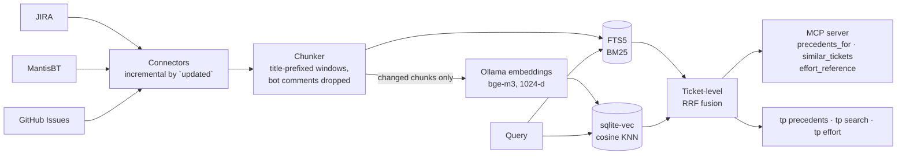

# ticket-precedent

[](https://github.com/bondie/ticket-precedent/actions/workflows/ci.yml)


**Have we solved this before?** Local hybrid search over your JIRA and helpdesk history,
exposed to AI agents through the [Model Context Protocol](https://modelcontextprotocol.io).

A customer reports *"the invoice never showed up in the shop"*. Eight months ago a developer
fixed the same thing in a ticket titled *"ERP comparator drops payload as unchanged"*.
Keyword search cannot connect the two, and pure embeddings fumble exact identifiers such as
ticket keys, class names and error codes. ticket-precedent indexes tickets **and their
comments** from JIRA (Server, Data Center and Cloud), MantisBT and GitHub Issues into a
single SQLite file and ranks them with BM25 and vector search fused by Reciprocal Rank Fusion.
Embeddings are computed locally with Ollama, so ticket content never leaves your machine.

In Claude Code (or any MCP client) you ask *"find precedents for helpdesk 18342"*, and the
agent gets the earlier tickets that look like it. The command line gives the same results
(illustrative output):

```text
$ tp precedents 18342
precedents for [acme-helpdesk] 18342 Invoice missing in the shop
1. [acme-jira] SHOP-412 ERP comparator drops payload as unchanged
   Done Fixed · 3.5 h · https://jira.example.com/browse/SHOP-412
   Root cause: the comparator hashed the payload without the PDF, so the re-sent invoice …
2. [acme-helpdesk] 17105 Credit note not visible in the customer account
   closed fixed · https://helpdesk.example.com/view.php?id=17105
   The ERP export finished but the shop kept the old document list. Resetting the …
```

## Try it in five minutes

All you need is [uv](https://docs.astral.sh/uv/). The demo downloads a ready-made index of
the 4,922 public [Apache ZooKeeper](https://issues.apache.org/jira/projects/ZOOKEEPER)
tickets with their comments (122 MB, the same index as in the [benchmark](#results)) and
runs a first search:

```bash
uvx ticket-precedent demo
```

It prints the commands to try next and the line that gives the index to Claude Code. Search
works right away with keywords only; for the semantic half, install
[Ollama](https://ollama.com) and `ollama pull bge-m3` as in step 1 below. The demo
configuration is an ordinary one: `tp sync` fetches the ZooKeeper tickets updated since the
index was built, anonymously from Apache JIRA.

## Getting started

You need [uv](https://docs.astral.sh/uv/) and [Ollama](https://ollama.com).

**1. Start Ollama and download the embedding model.** On macOS:

```bash
brew install ollama && brew services start ollama   # starts now and at every login
ollama pull bge-m3                                   # ~1.2 GB, multilingual
```

On Linux the [official installer](https://ollama.com/download) sets up a systemd service.

**2. Install ticket-precedent.**

```bash
uv tool install ticket-precedent     # puts `tp` on your PATH
```

To work on the code instead, clone the repository, run `uv sync` and prefix every command
with `uv run`.

**3. Describe your trackers.** The configuration lives in your home directory:

```bash
mkdir -p ~/.config/ticket-precedent
curl -o ~/.config/ticket-precedent/config.yaml \
  https://raw.githubusercontent.com/bondie/ticket-precedent/main/config.example.yaml
```

Edit the `sources` list, with one entry per JIRA query, MantisBT project set or set of
GitHub repositories. The `type` of a source is `jira` (Server and Data Center), `jira-cloud`,
`mantis` or `github`; see [Connectors](#connectors) for the authentication and limits of
each. Keep the secrets out of the file: `${VARIABLES}` are resolved from the environment,
from a `.env` next to the config, or from the files listed in `env_files`. See
[`config.example.yaml`](https://github.com/bondie/ticket-precedent/blob/main/config.example.yaml) for every option.

**4. Build the index.**

```bash
tp sync
tp stats            # tickets and chunks per source, last sync time
```

The first sync fetches everything and embeds about 15 chunks per second on an Apple M1 Pro.
A project with 3,600 tickets and their comments (17,000 chunks) takes about 20 minutes.
Later syncs fetch only tickets updated since the previous one and embed only changed text.
The index is a single file in `~/.local/share/ticket-precedent/`.

**5. Connect it to Claude Code.**

```bash
claude mcp add ticket-precedent -s user -- tp serve
```

`-s user` makes the tools available in every project. New Claude Code sessions pick them
up, and `claude mcp list` shows whether the server connects. Other MCP clients (Claude
Desktop, Cursor, …) start the same stdio server:

```json
{
  "mcpServers": {
    "ticket-precedent": {
      "command": "tp",
      "args": ["serve"]
    }
  }
}
```

## Connectors

| `type` | Tracker | Authentication |
|---|---|---|
| `jira` | JIRA Server / Data Center, REST API v2 | `username` + `password`, or `token` (personal access token) |
| `jira-cloud` | JIRA Cloud (`*.atlassian.net`) | `email` + `api_token`, or none for a public site |
| `mantis` | MantisBT REST API | `token` |
| `github` | GitHub Issues (github.com or Enterprise Server) | optional `token` |

- **JIRA Server / Data Center** reads `/rest/api/2/search`, 50 issues per request, with the
  changelog for [effort data](#effort-reference).
- **JIRA Cloud** removed that endpoint. The connector pages through
  `/rest/api/2/search/jql` with `nextPageToken`. The v2 endpoint returns descriptions and
  comments as plain text, while v3 returns them as Atlassian Document Format. Create the API
  token at [id.atlassian.com](https://id.atlassian.com/manage-profile/security/api-tokens).
  A page holds at most 100 issues, and in testing it carried at most 20 comments and 40
  changelog entries per issue; the connector fetches the rest of a longer thread or
  changelog with one more request for that issue, so effort data is as complete as on Server.
  JQL dates are read in the time zone of the API user, which the one-day overlap of
  incremental syncs absorbs. Tested anonymously against a public Cloud site; the `email` +
  `api_token` path is covered by tests only.
- **MantisBT** reads `/api/rest/issues` per project, newest first, and stops at the first
  page older than the last sync.
- **GitHub Issues** reads `/repos/{owner}/{repo}/issues`, 100 items per request, and skips
  pull requests (they are listed alongside issues and still cost requests). A full sync
  reads the repository's comment stream once, so it costs about (issues + pull requests +
  comments) / 100 requests. An incremental sync costs one request per page of changed issues
  plus one per changed issue that has comments, because every synced issue must carry its
  whole thread. Without a `token` GitHub allows 60 requests an hour, which a full sync spends
  on about 6,000 issues, pull requests and comments; a token (no scopes needed for public
  repositories) raises that to 5,000. When the limit runs out, the connector waits for
  the reset if it comes within `rate_limit_wait` seconds (default 3600) and otherwise stops
  with the reset time. A sync that stops starts again from the previous one, so a first sync
  of a large repository without a token needs the wait. After adding a repository to an
  existing source, run `tp sync --source NAME --full` once, because an incremental sync
  only asks for recently updated issues. Keys look like `acme/widget#123`, the status is
  `open` or `closed` and the resolution is GitHub's close reason (`completed`,
  `not_planned`, `duplicate`).
  Labels are not indexed, and there is no logged time, so GitHub issues do not take part in
  `effort_reference`. For GitHub Enterprise Server set `url` to its API base, for example
  `https://github.example.com/api/v3`.

## Everyday use

### Ask your agent

Describe the problem in your own words and let the agent pick the tool:

| You ask | The agent calls |
|---|---|
| *Find precedents for helpdesk 18342.* | `precedents_for("18342")` |
| *Have we seen "invoice PDF missing although ERP exported it" before?* | `similar_tickets(text)` |
| *Open SHOP-412 and tell me how it was fixed.* | `get_ticket("SHOP-412")` |
| *How long will SHOP-431 take?* | `effort_reference(key="SHOP-431")` |
| *How long did similar fixes take since we changed the process in January?* | `effort_reference(text, since="2026-01-01")` |

| Tool | What it does |
|---|---|
| `precedents_for(key, source?, only_source?, platform?, limit?)` | Precedents for a ticket, [fetched first](#tickets-that-are-not-indexed-yet) when it is not indexed yet |
| `similar_tickets(text \| query, source?, project?, platform?, limit?)` | Precedents for any text: a symptom, an error message; `query` is an alias of `text` |
| `effort_reference(key? \| text?, source?, since?, platform?, limit?)` | Similar finished tickets with logged hours, plus their median and P25–P75 |
| `get_ticket(key, source?)` | Full description, comments and links of one ticket |
| `list_sources()` | Indexed sources, counts and last sync time |

`precedents_for` queries with the ticket's title and description, exactly like the
[benchmark](#results). It returns only tickets created before that ticket and leaves out the
ticket itself. It also leaves out tickets named in the ticket's title: a JIRA issue titled
*"[R:18342] Wrong prices"* was opened from helpdesk thread 18342, so that thread is the same
problem, not a precedent. The key alone is enough, for `get_ticket` too. `source` is
needed only when two sources share a key.

`effort_reference` is the retrieval half of
[reference class forecasting](https://en.wikipedia.org/wiki/Reference_class_forecasting): an
estimate starts from how long similar work actually took. See
[Effort reference](#effort-reference).

Every result carries the key, title, URL, status, resolution, issue type, creation date,
time spent and a snippet of the best-matching text. `matched_in` says whether that text is
the description, a comment or only the title. `score` is the fusion score: it orders the results and is not a
probability. All tools are read-only. They search the local index; only a ticket that is
not indexed yet is [fetched from its tracker](#tickets-that-are-not-indexed-yet).

### Use the command line

| Command | What it does |
|---|---|
| `tp precedents KEY [--only-source S] [--platform P] [--limit N] [--json]` | Earlier tickets that look like a given ticket |
| `tp search TEXT [--source S] [--project P] [--platform P] [--mode hybrid\|vector\|bm25] [--json]` | Search by free text |
| `tp effort KEY [--since YYYY-MM-DD] [--platform P] [--limit N] [--json]` | Logged hours of similar tickets finished before KEY was created |
| `tp show KEY [--source S]` | Print one ticket as JSON (`tp show SOURCE KEY` also works) |
| `tp sync [--source S] [--full]` | Fetch new and updated tickets; `--full` re-reads everything |
| `tp stats` | Indexed sources and sync times |
| `tp serve` | MCP server on stdio (MCP clients start it for you) |
| `tp demo [--force]` | Download a ready-made index of public Apache tickets and try it |
| `tp eval PROJECT` | Benchmark on a public Apache JIRA project |

`tp --config PATH …` or `TICKET_PRECEDENT_CONFIG=PATH` uses another configuration file.

### Keep products apart

One index can hold the trackers of products that should not be compared, for example a
legacy shop platform and its successor: the same kind of ticket takes a very different
effort on each. Give every source a `platform` and the searches stay within one:

- `precedents_for` and `effort_reference` with a key keep to the platform of that ticket.
- `similar_tickets` and `effort_reference` with text use the `platform` argument, or
  `default_platform` from the configuration when it is omitted.
- `platform: "all"` searches every source; `list_sources` shows the platform of each.
- Platform names match regardless of case, and the MCP server lists the configured
  platforms, their sources and the default in its instructions, so the model knows the
  valid names before its first call.

Sources without a platform, and configurations without `default_platform`, search
everything as before.

### Keep the index fresh

- **Automatically.** With `auto_sync_hours` set, every new MCP session checks the sources
  when it starts. Any source older than that limit is refreshed in a background thread, so
  no scheduler is needed. A file lock keeps concurrent syncs (CLI, several open sessions) from
  colliding.
- **On demand.** `tp sync`, or a cron job.
- **When asked for.** See [below](#tickets-that-are-not-indexed-yet).
- **After changing chunking settings**, for example raising `min_comment_chars` to drop short
  "deployed, please check" comments, run `tp sync --full`. Unchanged chunks keep their
  embeddings, so this costs mostly API calls.

### Tickets that are not indexed yet

A ticket created after the last sync, or one from a project no sync has brought in, is
fetched when a tool needs it: `precedents_for`, `effort_reference` with a key and
`get_ticket`, and on the command line `tp precedents`, `tp effort` and `tp show`. The
ticket is indexed exactly as a sync would index it, comments and changelog included, and
the answer keeps the same rules: only tickets created before it, without the tickets its
title names. The sync state is left alone, so the next sync still fetches everything
updated since the previous one.

- **Which sources are asked.** The `source` argument when given, otherwise every source,
  one after another until one has the ticket. Sources whose indexed tickets already
  include the key's JIRA project, or whose `jql` names it, are asked first. A source
  answers only for tickets within its own scope: a JIRA source searches its `jql` plus
  `key = "…"`, a MantisBT source only its `project_ids`, a GitHub source only its `repo`
  list (pull requests excluded). A key of the wrong shape for a source (a helpdesk number
  for JIRA, `owner/repo#n` for MantisBT) costs no request.
- **What it costs.** One request per source asked, plus the requests for a long comment
  thread or changelog. A key that no source has is remembered for 10 minutes per server
  session, so asking again costs nothing; a failed request is not remembered, so the next
  call tries again. The lookup request is not retried and does not wait for a
  rate-limit reset, because an agent is waiting for the answer.
- **Credentials.** The MCP server needs the same tracker credentials in its environment as
  [auto-sync](#keep-the-index-fresh). A source whose `${VARIABLES}` are not set, or whose
  request fails, is skipped, and the error names each source asked and why it was skipped
  (an HTTP status or an error class, never a URL or a secret).
- **Ollama.** Fetching needs the embedding model too. When Ollama is down, the error says
  that the ticket was found but could not be embedded; read it from the tracker and use
  `similar_tickets`, which falls back to keywords.

### What has to be running

- **The MCP server** is started by the client (Claude Code, Cursor, …) for each session and
  stops with it. There is no daemon to manage.
- **Ollama** embeds the query. An idle Ollama server uses about 70 MB of RAM. The model is
  loaded on the first query (a few seconds) and unloaded after five idle minutes. If Ollama
  is not reachable, search degrades to BM25 and says so in a `warning` field instead of
  failing.

## Results

The benchmark asks the tool to find duplicates on public Apache JIRA projects (see the
[methodology](#evaluation-methodology)). Embeddings come from `bge-m3` through Ollama on an
Apple M1 Pro. The fusion parameters were tuned on ZooKeeper and applied to Derby unchanged.

**ZooKeeper**: 4,922 tickets, 105 duplicate queries

| Method | Indexed text | Hit@1 | Hit@5 | Hit@10 | MRR@10 (95% CI) |
|---|---|---:|---:|---:|---:|
| BM25 | title + description | 0.467 | 0.648 | 0.686 | 0.538 (0.45-0.63) |
| Vector | title + description | 0.600 | 0.762 | 0.790 | 0.662 (0.58-0.74) |
| Hybrid | title + description | 0.619 | 0.771 | 0.800 | 0.671 (0.59-0.75) |
| BM25 | + comments | 0.562 | 0.724 | 0.781 | 0.638 (0.55-0.72) |
| Vector | + comments | 0.610 | 0.829 | 0.838 | 0.695 (0.62-0.77) |
| **Hybrid** | **+ comments** | **0.648** | **0.838** | **0.857** | **0.719 (0.64-0.80)** |

**Derby** (held out): 7,169 tickets, 153 duplicate queries

| Method | Indexed text | Hit@1 | Hit@5 | Hit@10 | MRR@10 (95% CI) |
|---|---|---:|---:|---:|---:|
| BM25 | title + description | 0.418 | 0.595 | 0.673 | 0.500 (0.43-0.57) |
| Vector | title + description | 0.490 | 0.634 | 0.699 | 0.551 (0.48-0.62) |
| Hybrid | title + description | 0.490 | 0.654 | 0.725 | 0.559 (0.49-0.63) |
| BM25 | + comments | 0.425 | 0.667 | 0.732 | 0.532 (0.46-0.60) |
| Vector | + comments | 0.556 | 0.752 | 0.791 | 0.636 (0.57-0.70) |
| **Hybrid** | **+ comments** | **0.562** | **0.752** | **0.797** | **0.647 (0.58-0.71)** |

What the numbers say:

- **Indexing comments gives the biggest gain.** With comments, hybrid Hit@10 rises by 6 to 7
  points and MRR by 0.05 to 0.09. Comments hold the diagnosis (stack traces, class names,
  the root cause) that the original description often lacks.
- **Embeddings beat BM25 on every run**, by 0.05 to 0.12 MRR. Duplicates are reported by
  different people in different words.
- **Hybrid is the best or tied on every run, but the right BM25 weight depends on the
  project.** On ZooKeeper without comments, plain RRF (`k=60`, equal weights) scored 0.599
  MRR, which is *below* vectors alone (0.662). With `rrf_k=10` and the lexical ranking
  weighted 0.25, it reaches 0.671. Derby was not used for tuning, and it prefers a heavier
  BM25 weight: with comments, equal weights reach 0.661 and the default reaches 0.647. The
  default of 0.25 is the conservative choice, because it scored above vector search on all
  four runs. Neither these differences nor hybrid's lead over pure vector search (0.01 to
  0.02 MRR) are larger than the confidence intervals, so the benchmark does not prove that
  hybrid is better. Hybrid stays the default because exact identifiers (error codes, ticket
  keys, class names) are where BM25 is strong and embeddings are weak, and this benchmark
  does not isolate that case.
- **Latency.** At p50, searching the local index takes 15 to 50 ms without comments. With
  comments it takes up to 212 ms (hybrid over Derby's 61k chunks). Embedding the query
  adds about 0.2 s (1,000 characters, model already loaded).

### Reranking: tried, not adopted

A cross-encoder that reads the query and each candidate together is the usual next step after
hybrid retrieval, so `bge-reranker-v2-m3` was measured on top of the hybrid results (with
comments). The settings were chosen on ZooKeeper and Derby was run once, unchanged. The
differences are paired: each query's reciprocal rank with the reranker minus without it,
bootstrapped over the queries.

| Run | Method | Hit@1 | Hit@10 | MRR@10 | ΔMRR@10 (95% CI) | Better / worse |
|---|---|---:|---:|---:|---:|---:|
| ZooKeeper | hybrid | 0.648 | 0.857 | 0.719 | | |
| ZooKeeper | reranker on the top 10 | 0.495 | 0.857 | 0.613 | −0.106 (−0.179 to −0.033) | 13 / 32 |
| ZooKeeper | reranker on the top 50 | 0.390 | 0.762 | 0.506 | −0.213 (−0.292 to −0.133) | 12 / 44 |
| ZooKeeper | hybrid + reranker (RRF) | 0.648 | 0.857 | 0.723 | +0.004 (+0.000 to +0.009) | 5 / 2 |
| Derby | hybrid | 0.562 | 0.797 | 0.647 | | |
| Derby | reranker on the top 10 | 0.340 | 0.797 | 0.470 | −0.177 (−0.239 to −0.119) | 15 / 59 |
| Derby | reranker on the top 20 | 0.301 | 0.739 | 0.415 | −0.233 (−0.301 to −0.165) | 16 / 69 |
| Derby | hybrid + reranker (RRF) | 0.562 | 0.797 | 0.649 | +0.002 (−0.007 to +0.011) | 5 / 3 |

- **Reordering by the reranker hurts, and the wider the pool, the more.** On both projects
  the whole interval is below zero. Giving it the candidate's title and description instead
  of the matched chunk did not change that (ZooKeeper top 10 at 1,024 tokens: −0.129 with
  title and description, −0.119 with the chunk), nor did 1,024 tokens instead of 512.
- **As an extra signal it adds nothing.** Fusing the reranker's order into the hybrid order
  (pool 10, `rrf_k` 10, weight 0.25, the best of a 16-point grid on ZooKeeper) moves MRR by
  +0.004 and +0.002, within noise.
- **It is slow.** On an Apple M1 Pro (MPS) the reranker takes 2.7 s per query for 20
  candidates (Derby) and 5.6 s for 50 (ZooKeeper), against 0.1 to 0.2 s for the hybrid
  search itself.
- **A likely reason, not proven here:** a reranker scores how well a passage answers a
  query, so it promotes tickets on the same topic. For a NULL dereference in the C client
  it put first a ticket about compiling the C client with an old gcc, and the real
  duplicate fell from 1st to 9th (ZooKeeper, top 50, 1,024 tokens). Finding a duplicate is
  a different question: whether two descriptions report the same fault.

What was not measured: the queries here are a full title and description (up to 2,000
characters), while an agent often searches with a short phrase, which is closer to the
question-and-passage setting rerankers are built for. Other rerankers were not tried
either. Search stays without a reranker; the script and the per-query ranks are kept so
the result can be checked or rerun with another model or with shorter queries:

```bash
uv run --with sentence-transformers python scripts/eval_rerank.py \
    ~/.local/share/ticket-precedent/eval/apache-zookeeper-comments-bge-m3.db \
    --candidate chunk --max-length 512 --top 50 --grid --out results/rerank-zookeeper-chunk-512.json
```

Reproduce a run, or the fusion parameter grid, with:

```bash
uv run tp eval ZOOKEEPER --no-comments       # ~5k tickets, about 10 minutes
uv run tp eval DERBY --out results/derby-comments-bge-m3.json
uv run python scripts/tune_fusion.py ~/.local/share/ticket-precedent/eval/apache-derby-comments-bge-m3.db
```

The per-query ranks for every run are in [`results/`](https://github.com/bondie/ticket-precedent/tree/main/results).

## How it works



- **One file, no services.** FTS5 and [sqlite-vec](https://github.com/asg017/sqlite-vec)
  live in the same SQLite database as the tickets, so the index is easy to back up, move
  or throw away.
- **Hybrid ranking.** BM25 catches exact tokens (error codes, class names), embeddings catch
  paraphrases and cross-language matches. Reciprocal Rank Fusion merges the two rankings
  without calibrating their scores against each other.
- **Ticket-level results.** Every chunk carries the ticket title. Chunks are ranked first and
  then collapsed to their best chunk per ticket, so a long thread cannot crowd out the list.
- **Incremental sync.** Chunks are content-hashed and only new or changed text is embedded.
  Re-syncing an unchanged project costs API calls but no GPU time.
- **Long queries.** A pasted ticket can have hundreds of terms. The lexical side keeps the
  64 rarest terms that exist in the index, using FTS5 vocabulary statistics.
- **Multilingual.** bge-m3 handles mixed Czech and English. BM25 folds diacritics, so
  *objednávka* and *objednavka* match.

## Effort reference

`effort_reference` answers "how long did work like this take?" with the logged time of the
most similar tickets, never with a model's guess. It is meant as the input of an estimating
agent, which adjusts the range and cites the tickets.

- **Only finished work counts.** A ticket joins the reference class once its time was all
  logged, so a ticket still in progress cannot pull the median down. For a ticket given by key
  the cut-off is the moment it was created: the answer is what could have been known when it
  was estimated. That makes the tool usable for backtests without leaking the future.
- **When was the time final?** The JIRA connectors read each issue's changelog and keep
  the moment time was last logged. When sub-tasks carry part of the time, their worklogs
  are not in the parent's changelog, so the last update stands in for it.
- **What did people forecast?** The index also keeps the original estimate as it stood when
  the first time was logged. Trackers often raise the estimate to match the time spent once
  the work is done, so the current value is a record of the effort, not a forecast. The tool
  never returns it: it is there to compare an agent's estimate with the human one.
- **Process changes.** `since` keeps only tickets created after a date. When a team changes
  how it works, for example by implementing with AI agents, older tickets overstate the
  effort and a recent reference class is the better guide. `effort_since` in the
  configuration sets that date once, for every platform (`effort_since: 2026-01-01`) or per
  platform (`effort_since: {shop: 2026-01-01}`), and applies whenever `since` is not
  passed. The response carries the `since` that was used, and an explicit one always wins.
- **Quartiles, not a mean.** Logged time is skewed: a few tickets take ten times the usual.
  The median and the P25–P75 range ignore the outliers that a mean would chase.

The changelog makes JIRA pages slower, so sources sync 50 issues per request. Set
`changelog: false` on a source that does not need effort data. After upgrading from an
index without these fields, run `tp sync --full` once.

## Evaluation methodology

There is no labelled "precedent" dataset for private trackers, but public issue trackers
contain one implicitly: tickets **closed as duplicates**.

- Corpus: every ticket of an Apache JIRA project, fetched anonymously through the REST API.
- Queries: each ticket resolved as *Duplicate*, using only its title and description
  (truncated to 2,000 characters), which is what a reporter writes before anyone answers.
- Relevant answers: the **earlier** tickets in the same duplicate cluster (connected
  component of *Duplicate* links).
- No leakage from the future: search is restricted to tickets created before the query,
  and the query ticket itself is excluded.
- Metrics: Hit@k (a relevant ticket is in the top k) and MRR@10. The 95% interval for MRR is
  a percentile bootstrap: 2,000 resamples of the queries with a fixed seed.

Caveat: the index reflects the trackers' current state, so a comment written on an original
ticket after the duplicate was filed can still help the search. Titles and descriptions,
the bulk of the signal, rarely change after creation.

## Development

```bash
uv sync
uv run pytest --cov          # unit and integration tests, no network or GPU needed
uv run ruff check . && uv run ruff format --check .
uv run mypy                  # strict mode
uvx pre-commit install       # ruff, mypy and gitleaks on every commit
```

CI runs lint, type checks, tests on Python 3.11–3.13 and a gitleaks secret scan.

## Roadmap

- Collapse clones and sub-tasks that share a title into one result
- A reranker trained on duplicate pairs, or an LLM judging the top 5; a general-purpose
  cross-encoder made results worse (see [Reranking](#reranking-tried-not-adopted))
- Embedding model comparison (`qwen3-embedding`, `multilingual-e5`, `snowflake-arctic-embed2`)
- GitLab connector
- Periodic re-sync while a server session stays open (today auto-sync runs only at start-up)

## License

[MIT](https://github.com/bondie/ticket-precedent/blob/main/LICENSE)
